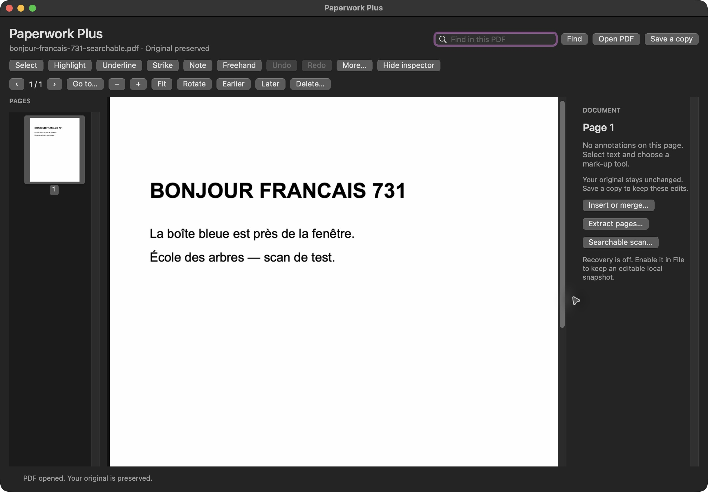
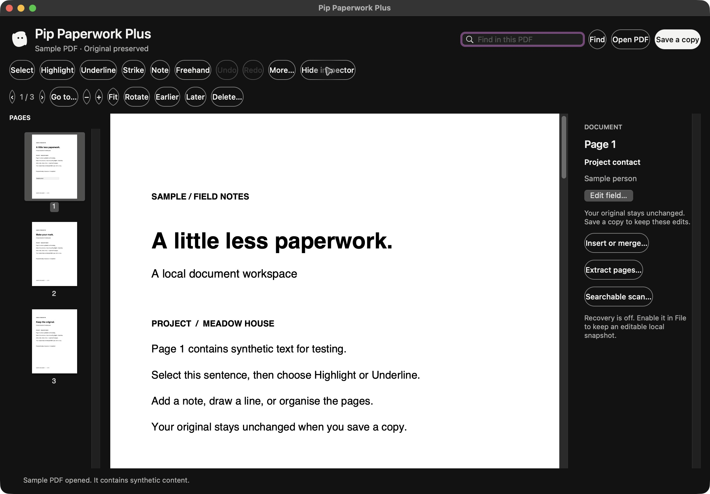

# Pip Paperwork — local PDF reader and markup for macOS

A local PDF workspace for macOS. Read, mark up and organise documents, then save a separate copy while keeping your original.

**Experimental alpha.** This custom repository contains the neutral/Pip foundation and matched Plus variants. Selected Core and Plus workflows have been verified in the packaged apps on macOS 27.0.1; [TESTING](TESTING.md) records their scope and remaining checks. Build from source using the steps below. If [Releases](https://github.com/Ghostzy0/pip-paperwork/releases) lists a packaged prerelease, its entry provides the download and checksums. The separate [Paperwork Replica](https://github.com/Ghostzy0/pip-paperwork-replica) repository tracks an original recreation of observed PDF Expert workflows.

## On your Mac

- Read PDFs with page thumbnails, text selection, zoom and search.
- Highlight, underline, strike through, add sticky notes and draw freehand.
- Fill supported form fields; organise pages with rotate, move, delete, insert and merge.
- Extract page ranges or split pages into files. Export text, page PNGs, editable PDF copies, flattened copies and image-optimised copies.
- Recognise English scanned text on-device and export a separate flattened searchable PDF.
- Undo document changes and optionally keep a local recovery copy.

No account, network service, provider key or model download is needed. There is no telemetry or updater. PDF links and embedded remote actions are inert. The app does not provide redaction, certificate signing, arbitrary PDF text editing, Office conversion or full vendor parity.

## Build and try it

Requires an Apple silicon Mac and Apple’s command-line developer tools (`xcode-select --install`, completed by you if missing). macOS 14 is the deployment target; native development testing has run on macOS 27, and minimum-version GUI compatibility remains unverified. The first build needs internet access to download a checksum-pinned Go toolchain and locked modules. The built app runs locally without those build downloads.

```sh
./scripts/test.sh
./scripts/build.sh baseline
./scripts/build.sh pip
./scripts/build.sh baseline-plus
./scripts/build.sh pip-plus
open 'build/Pip Paperwork.app'
```

Use **Open sample** for a synthetic three-page document with a text field. Select text and choose Highlight, add a note, rotate a page, fill the sample field, then Save a copy. Open that output to inspect the changes. The baseline is `build/Paperwork Baseline.app`. All four editions use distinct bundle identities and recovery locations. Plus adds a choice of one OCR language from Vision’s runtime-supported list and a Hide/Show inspector control with a View-menu alternative. Core keeps its historical English OCR request. The Plus packages are `build/Paperwork Plus.app` and `build/Pip Paperwork Plus.app`. Source builds and prereleases are experimental; the verification record identifies each tested workflow and remaining limit.

A local build is ad-hoc signed, not Developer ID signed or notarised. For a downloaded release, macOS may ask you to confirm its source using the normal per-app opening flow. Do not disable Gatekeeper globally. No installer, system extension or background service is required. Delete the app to remove the executable; document and recovery data are separate.

[How to read, annotate and save](docs/HOW-TO.md) · [FAQ](docs/FAQ.md) · [AI setup prompt and verification](docs/AI-SETUP.md) · [Privacy and storage](docs/PRIVACY.md) · [Provenance](UPSTREAM.md) · [Known gaps](PARITY.md) · [Change notes](CHANGELOG.md)

## Selected native examples

Captured from the packaged Plus apps on macOS 27.0.1, revision [`7a806fe`](https://github.com/Ghostzy0/pip-paperwork/commit/7a806fe987efd2c2e7dc67f6344f057c1d7e2f08), using authored synthetic documents. See [testing details](TESTING.md#selected-plus-native-observations--24-october) for exact executable hashes, observed steps and open checks.



*Neutral Plus — synthetic French searchable copy reopened after save; one observed scenario.*



*Pip Plus — bundled synthetic sample with the inspector restored using Cmd-Shift-I; one observed scenario.*

## Shared engine identity

`SHARED-CORE.sha256` records the PDF/OCR/recovery/sample engine and canonical-writer sources shared by the configurations. Verify it from the repository root with `shasum -a 256 -c SHARED-CORE.sha256`. The separate recreation repository must preserve or explicitly explain this source pin; matching hashes do not establish functional or visual parity.

## File safety and limits

The opened PDF is treated as the protected original. Save requires a new `.pdf` filename; existing files, aliases and hardlinks are refused. To revise an earlier export, reopen it and save under another name. Normal saves retain editable annotations/forms where PDFKit supports them. Flattening and OCR are separate exports and lose editable annotations/form controls. Optimisation may change image detail and may not reduce size.

Input is limited to 180 MB and 2,000 pages. OCR is limited to 100 pages and media dimensions of 2,400 PDF points per side; recognition can make mistakes. Encrypted PDFs can be unlocked for reading but cannot be rewritten here. Signature markers/widgets are conservatively treated as read-only; this is not signature verification. Restricted files are not bypassed. Keep backups for important documents and verify saved copies with another reader.

## About

Maintained by [Ghostzy0](https://github.com/Ghostzy0). Original MIT app code, using macOS PDFKit/Vision and the system font. PDFKit/Vision plus the pinned Apache-licensed pdfcpu canonical writer; no model weights. Workflow references: [PDF Expert](https://pdfexpert.com/), [Adobe Acrobat](https://www.adobe.com/acrobat.html), and [Apple PDFKit](https://developer.apple.com/documentation/pdfkit). Trademarks belong to their respective owners. Screenshots above are from the actual packaged app and use synthetic content.
